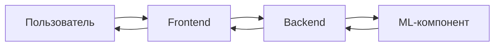

# Архитектура системы

## 1. Назначение

Система представляет собой прототип кредитного кабинета для бизнеса. Репозиторий разделяет пользовательский интерфейс, серверную часть и ML-компонент на отдельные каталоги.

## 2. Компоненты

| Компонент | Ответственность |
|---|---|
| Frontend (`frontend/`) | Отображение интерфейса и сбор пользовательского ввода |
| Backend (`backend/`) | Серверная обработка запросов и координация бизнес-логики |
| ML (`ml/`) | Подготовка данных, обучение модели и/или получение прогноза |
| Docker Compose | Оркестрация контейнеров при совместном запуске |

Точный перечень внутренних модулей и способ связи backend с ML необходимо сверять с актуальным кодом.

## 3. Логический поток обработки

Диаграмма отражает логическую схему взаимодействия, а не гарантирует конкретный сетевой протокол или отдельный ML-сервис. Если модель загружается непосредственно в backend, блоки backend и ML могут работать в одном процессе.

## 4. Типовой сценарий скоринга

1. Пользователь инициирует оценку заявки и указывает необходимые параметры.
2. Сервер проверяет входные данные и получает дополнительные сведения, если это предусмотрено приложением.
3. Формируется набор признаков в формате, ожидаемом моделью.
4. CatBoost возвращает предсказанный класс риска и, если используется `predict_proba`, оценки вероятностей классов.
5. Сервер передаёт результат интерфейсу.
6. Приложение отображает результат в рамках пользовательского сценария.

Этот сценарий описывает назначение системы. Точные поля, проверки, ошибки и переходы состояний нужно документировать по фактической реализации.

## 5. Запуск и конфигурация

Корневой `docker-compose.yml` задаёт контейнерную конфигурацию проекта. При диагностике запуска проверьте:

- какие сервисы объявлены в Compose;
- какие Dockerfile используются;
- какие порты опубликованы;
- какие переменные окружения необходимы;
- как передаются файлы модели и данные;
- настроены ли healthcheck и зависимости между сервисами.

## 6. Рекомендации по развитию

- Зафиксировать контракт между backend и ML в одном месте.
- Валидировать входные данные на границе API.
- Добавить идентификатор версии модели к результатам скоринга.
- Логировать ошибки и технические метрики, не записывая избыточные персональные/финансовые данные.
- Отделить технический прогноз модели от бизнес-решения по заявке.
- Добавить интеграционные тесты полного сценария.
